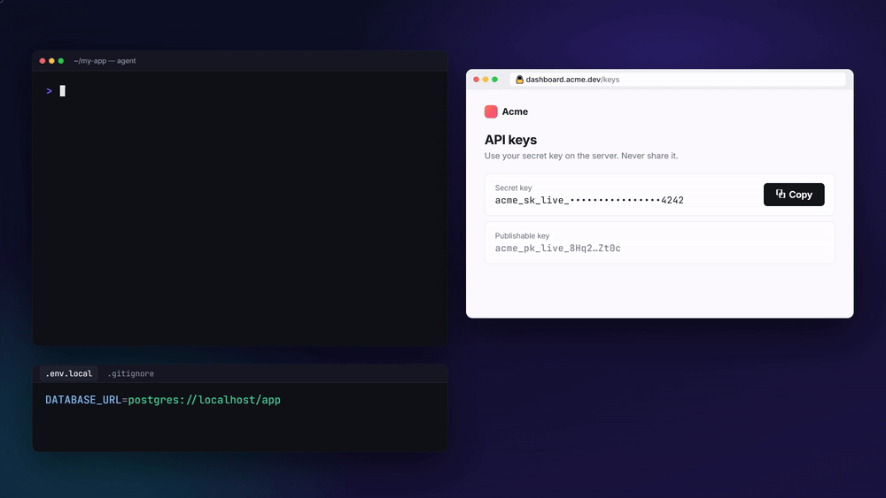

<p align="center">
  <picture>
    <source media="(prefers-color-scheme: dark)" srcset="https://raw.githubusercontent.com/HenryyXD/keepkeys/main/docs/assets/keepkeys-dark.svg">
    <source media="(prefers-color-scheme: light)" srcset="https://raw.githubusercontent.com/HenryyXD/keepkeys/main/docs/assets/keepkeys-light.svg">
    
  </picture>
</p>

<p align="center">
  <a href="https://github.com/HenryyXD/keepkeys/actions/workflows/ci.yml"></a>
  <a href="LICENSE"></a>
  
  
</p>

<p align="center">
  <b>Don't paste API keys into your AI chat. Just copy the key; keepkeys writes it to your <code>.env</code> file.</b>
  <br>
  <sub><b>K</b>eys <b>E</b>xcluded from <b>E</b>very <b>P</b>rompt</sub>
</p>

<p align="center">
  
  <br>
  <sub>Keys keepkeys recognises (Stripe, OpenAI, Anthropic, …) are saved straight away; others, like this made-up Acme key, get a one-click confirm page first.</sub>
</p>

Your coding agent needs an API key in `.env` (or `.env.local`). Instead of pasting it into the chat, or creating the file by hand, you **just copy it**: click "Copy" in the provider's dashboard. keepkeys picks it up from the clipboard, writes it to the right files, adds them to `.gitignore` and clears the clipboard. A desktop notification confirms it. The agent only learns `ok, ends in …4242`.

- **Zero dependencies.** One `npx` command, Node 18.19+, Windows, macOS and Linux, including servers over SSH.
- **Works with any agent.** It has an MCP server for Claude Code, Cursor and other MCP clients. A plain CLI covers everything else.
- **The value stays out of the chat.** Tool results, logs and notifications show only the last 4 characters (`…4242`).
- **Small and honest.** It doesn't try to be a vault (see [What this is NOT](#what-this-is-not)).

## Quick start

```bash
npx keepkeys setup
```

This registers keepkeys with Claude Code and/or Cursor, whichever it finds; start a new agent session, and the next time the agent needs a key it asks you to copy it instead of pasting it. Details and other agents are under [Install](#install).

### Quick start by situation

| Where the agent runs | What you do |
|---|---|
| **Your own computer** (macOS, Windows, Linux desktop) | `npx keepkeys setup` once. When the agent asks, click "Copy" in the provider's dashboard. |
| **A server you reach over SSH** (homeserver, VPS, no desktop) | The agent gives you one command, e.g. `npx -y keepkeys --root ~/app`. Run it in your SSH terminal and paste each key into the hidden prompt. That's it. |
| **A server without Node** | Ubuntu 24.04 / Debian 12: `sudo apt install -y nodejs npm` (Node 18.19+ is enough), then the row above. |
| **A dev container, Codespace or VM** you can open a terminal in | Same as the SSH row: run the command the agent prints in that terminal. |
| **A hosted agent you have no terminal into** (a web-based coding agent's sandbox) | keepkeys can't reach it without sending your key through someone else's server, which it never does. Use that platform's own secrets or environment settings. |
| **The project belongs to another user**, or you use `sudo` | Either works: keepkeys keeps the file's owner and mode. `sudo -u <owner> npx keepkeys` is the cleanest. |

Running it yourself in a terminal is always the shortest path: `npx keepkeys` reads `.env.example`, lists what is missing and asks for each key with a hidden prompt (one paste per key, no Enter).

---

## The problem

Vibe coding usually goes like this:

> **Agent:** I've added Stripe checkout. Please give me your `STRIPE_SECRET_KEY` so I can put it in `.env.local`.
> **You:** *pastes `sk_live_…` into the chat*

That key now sits in the conversation transcript and the agent's logs. Depending on the tool, it may also end up in a provider's servers, a shared session, or a screenshot. It is also one step away from being written into a file that gets committed.

The numbers from GitGuardian's [State of Secrets Sprawl 2026](https://www.gitguardian.com/state-of-secrets-sprawl-report-2026) ([summary](https://blog.gitguardian.com/the-state-of-secrets-sprawl-2026/)):

| | 2025 |
|---|---|
| New hardcoded secrets on public GitHub | **28.65 million** (+34% year over year, the largest jump in the report's history) |
| Leaked secrets for AI services | **1,275,105** (+81%) |
| Commits made with Claude Code that leaked a secret | **3.2%**, vs. a 1.5% baseline for all public commits |
| Unique secrets found in MCP configuration files | **24,008** |

Good tools already exist for secrets: vaults and secret managers ([1Password](https://developer.1password.com/docs/cli/), [Doppler](https://www.doppler.com/), [Infisical](https://infisical.com/)), env tooling ([varlock](https://varlock.dev/)), and agent-specific proxies and vaults (AgentSecrets, API Stronghold, amux vault). They solve harder problems than this one. None of them covers the small, everyday step: **the agent asks, you press Ctrl+V, and the agent never sees the value.** keepkeys does only that step.

## How it works

1. The agent says *"Copy your `STRIPE_SECRET_KEY` from dashboard.stripe.com/apikeys"* and calls the `request_secret` MCP tool, or runs `npx keepkeys add STRIPE_SECRET_KEY`. A notification says **keepkeys: copy STRIPE_SECRET_KEY**.
2. You copy the key, or copy it again if you already had. A notification shows **Got it ✓ STRIPE_SECRET_KEY …4242**.
3. keepkeys writes the value to every destination, replacing the line if one exists, makes sure each file is in `.gitignore`, and clears the clipboard.
4. The agent receives `ok: saved STRIPE_SECRET_KEY (ends in …4242) to .env.local, server/.dev.vars` and tells you it arrived.

### How you know the copy worked

A click on "Copy" can fail without any sign. So keepkeys tells you what happened, not just the agent:

- **Notifications.** You get one while it waits ("copy STRIPE_SECRET_KEY now"), one when it gets the key ("Got it ✓ …4242"), and one when it ignores something you copied ("that didn't look like a Stripe key, copy it again").
- **Only a new copy counts.** Whatever was on the clipboard before the request is never used, so a request can't quietly grab something you copied earlier. Copying the same key again does count (Windows and macOS count every copy; on Linux, copy something else first).
- **Only key-shaped copies count.** Ordinary copies are ignored: sentences, URLs, file paths, emails, text with spaces.
- **Unsure? It asks first.** A key with the prefix the name expects (`sk-or-v1-` for `OPENROUTER_API_KEY`, `sk_`/`rk_` for `STRIPE_SECRET_KEY`) is saved straight away. For anything else, a page asks *"Save the value ending …abcd?"* before saving. That covers unknown providers, a different prefix, or a warning such as a `pk_` key in a secret variable. The agent can say what format to expect (`expected_prefixes`, e.g. `["sk-ant-"]`, or `expected_pattern`); that only sharpens the warning and never skips the page. The agent never learns that page's address, so it can't answer for you.
- **The agent confirms in chat.** The result tells it to say "received, ends in …4242". If nothing arrives within 5 minutes, it is told the copy didn't register and to ask you again or switch to the browser page.
- **You can check any time** with `npx keepkeys list` (or the `secrets_status` tool).

### Other ways to hand over a key

- **Browser page:** `--browser`, or `method: "browser"` in MCP. A page opens on `127.0.0.1`; you paste into it. Use it when the clipboard can't be read (e.g. Linux without `xclip`/`wl-clipboard`) or when you prefer pasting. keepkeys switches to it on its own if the clipboard isn't available.
- **Terminal prompt:** when you run `npx keepkeys` or `npx keepkeys add NAME` yourself in a terminal, including over SSH, a hidden prompt appears. One paste submits it, with no Enter. Nothing is echoed, and nothing reaches the shell history: the value is never an argument.
- **On a server or over SSH, the agent hands you a command.** Without a terminal and without a display, keepkeys can't watch a clipboard or open a page that you would see. So instead of waiting, it prints the one command for you to run in your own terminal (exit code 4), and the MCP tools return it to the agent at once. See [For agents](#for-agents).

Every route cleans up paste accidents (spaces, quotes, a pasted `NAME=` prefix) and checks the provider prefix. For example, it warns before storing a `pk_` key in `STRIPE_SECRET_KEY`.

## Install

### Claude Code

Tell your agent *"install keepkeys"*, or run:

```bash
npx keepkeys setup
```

`setup` finds Claude Code and Cursor and registers the MCP server with each. For Claude Code it does that through `claude mcp add --scope user`. You can also do it by hand:

```bash
claude mcp add --scope user keepkeys -- npx -y keepkeys mcp
```

On native Windows, use `-- cmd /c npx -y keepkeys mcp`; `setup` does this for you. Start a new Claude Code session afterwards to load the server.

### Cursor

```bash
npx keepkeys setup cursor
```

That adds this to `~/.cursor/mcp.json`; for one project only, add `--project` and it goes to `.cursor/mcp.json`:

```json
{
  "mcpServers": {
    "keepkeys": { "command": "npx", "args": ["-y", "keepkeys", "mcp", "--root", "${workspaceFolder}"] }
  }
}
```

### Any other agent (no MCP)

Agents that can run shell commands can use the CLI directly. When there is no terminal to prompt in, which is normal for an agent's shell, keepkeys waits for you to copy the key (or opens the browser page with `--browser`):

```bash
npx keepkeys add OPENAI_API_KEY --to .env.local
```

### Agent rules (optional)

```bash
npx keepkeys setup --rules
```

This adds a short "never ask for secrets in chat; use keepkeys" section to `CLAUDE.md` and/or `AGENTS.md`. The MCP server also sends the same guidance to the agent in its instructions.

More detail is in [docs/claude-code.md](docs/claude-code.md) and [docs/cursor.md](docs/cursor.md).

## Using it yourself

<p align="center">
  
  <br>
  <sub>The CLI in your own terminal</sub>
</p>

```bash
npx keepkeys                                   # what's missing? then ask for each one
npx keepkeys add STRIPE_SECRET_KEY --to .env.local,server/.dev.vars --where https://dashboard.stripe.com/apikeys
npx keepkeys add OPENROUTER_API_KEY --clipboard          # just copy the key; keepkeys picks it up and clears the clipboard
npx keepkeys add OPENROUTER_API_KEY --browser            # paste it into a local page instead
npx keepkeys add ANTHROPIC_API_KEY --check               # one read-only call to confirm the key works
npx keepkeys add GITHUB_TOKEN --to env:user              # a user environment variable instead of a file
npx keepkeys list --json                                 # status for scripts and agents; never values
```

<details>
<summary><b>All <code>add</code> options</b></summary>

| Option | Meaning |
|---|---|
| `--to a,b` | Destinations: env files and/or `env:user`. Defaults to the manifest; else an existing `.env.local` or `.env`; else `.env.local` in Next.js / Vite / Astro / SvelteKit / CRA / Vue CLI projects; else `.env`, which every dotenv loader reads. |
| `--where URL` | Where to get the key; shown while asking. Known providers get a link automatically. |
| `--description TEXT` | What the key is for. |
| `--clipboard` | Wait for you to copy the key, then clear the clipboard. The default for an agent on a desktop. Fails at once where there is no clipboard (servers, SSH). |
| `--browser` | Paste into a local page instead. The default for several keys at once on a desktop. Over SSH it prints the `ssh -L` tunnel to open. |
| `--stdin` | Read from standard input, for scripts. |
| `--timeout SEC` | How long to wait (clipboard 300, browser 600). |
| `--check` | Validate with the provider: Anthropic, OpenAI, OpenRouter, Stripe, GitHub, Groq, Google, Hugging Face. |
| `--yes` | Save even if the value looks wrong. |
| `--root DIR` | Project directory (default: the current directory). |

</details>

### The manifest: `.env.example` or `keepkeys.json`

Key **names** and **destinations** live in git; **values** never do. keepkeys reads your existing `.env.example` and understands comment directives above a variable:

```bash
# Stripe secret key for the API server
# where: https://dashboard.stripe.com/apikeys
# to: .env.local, server/.dev.vars
STRIPE_SECRET_KEY=

# optional
POSTHOG_KEY=

PORT=3000            # a plain setting: not asked for
# secret
SIGNING_SALT=abc123  # "# secret" makes keepkeys ask for it anyway
```

<details>
<summary><b>What counts as a secret</b></summary>

- **Asked for:** entries with an empty or placeholder value (`<your key>`, `xxx`, `sk_test_...`), and names that say secret (`*_SECRET`, `*_TOKEN`, `*_API_KEY`, `*_PASSWORD`).
- **Left alone:** other entries with a real-looking example value, such as `PORT=3000` or `NODE_ENV=development`. Those are settings.
- **`# optional` and `# secret`** must be the whole comment line.

</details>

If you'd rather keep this out of `.env.example`, use `keepkeys.json` instead. It wins over `.env.example`:

```json
{
  "defaults": { "to": [".env.local"] },
  "keys": {
    "STRIPE_SECRET_KEY": {
      "description": "Stripe secret key for the API server",
      "where": "https://dashboard.stripe.com/apikeys",
      "to": [".env.local", "server/.dev.vars"]
    },
    "POSTHOG_KEY": { "optional": true }
  }
}
```

### Destinations

Env files in the project, or `env:user` for a variable every new terminal sees. Prefer files.

<details>
<summary><b>How each destination is written</b></summary>

- **Env files** (`.env`, `.env.*`, `*.env`, `.dev.vars`, `.envrc`): one `NAME=value` line (`export NAME=value` in `.envrc`, so direnv passes it on). An existing line is replaced in place; comments, other keys, CRLF line endings and a BOM are kept. Each file is added to `.gitignore`. keepkeys warns loudly if the file is **already committed**, because `.gitignore` can't fix that.
- **`env:user`**: a variable every new terminal sees.
  - **Windows:** a user environment variable (HKCU). There is no `setx` 1024-character limit, and the value never appears on a command line.
  - **macOS/Linux:** one `export NAME='…'  # keepkeys` line in `~/.zshrc`, `~/.bashrc`/`~/.bash_profile`, or fish `conf.d`. It is replaced, never duplicated.
  - **Caveat:** it only applies to terminals opened afterwards, and **every program you run can read it.** Prefer files.

</details>

## For agents

What to tell the user depends on where you run. keepkeys works this out itself; follow what it returns.

- **Desktop, MCP** (`request_secret`): say *"When the keepkeys notification appears, copy your `NAME` from `<where>`"*, then call the tool. After it returns, confirm *"received, ends in …abcd"*.
- **Server or SSH, MCP**: `request_secret` / `request_missing_secrets` return at once with `not saved yet:` and a command. Give the user that exact command in one line: *"Run this in your terminal and paste each key when it asks (it stays hidden): `npx -y keepkeys --root ~/app`"*. When they say it's done, call `secrets_status`.
- **No MCP, your shell has no terminal**: run `keepkeys` (all missing keys) or `keepkeys add NAME --to .env`. Exit code 4 means the last line of stdout is the command to give the user; then check with `keepkeys list --json`.
- **Never** ask the user to paste a key into the chat, to put it in a command line (`keepkeys add X --stdin <<< sk-…` lands in the shell history), or to edit `.env` while you watch. If they paste one anyway, tell them to rotate it.
- **No terminal the user can reach at all** (you run in a hosted sandbox): say so plainly and point them to the platform's secret settings. Don't invent a workaround that routes the key through a third party.

## Safety rules

The MCP server lets the *agent* choose a name and destinations, so it is strict:

- It only writes env-style files **inside the project**: no `../`, no `~/.ssh/config`, no `src/app.js`. Symlinks that point outside are refused.
- `env:user` is refused unless you start the server with `--allow-env-user`.
- Variable names must match `[A-Za-z_][A-Za-z0-9_]*`.
- The page is served only on `127.0.0.1`, behind a random one-time URL. It only answers to loopback host names (`127.0.0.1`, `localhost`; any port, so an `ssh -L` tunnel works), POSTs must come from that same origin, and it has a strict Content-Security-Policy, so other websites can't post to it (or reach it through DNS rebinding). It closes after use or after 10 minutes.
- Values never go to stdout, logs, notifications or tool results. Only the last 4 characters are shown, and nothing at all for values of 8 characters or fewer.
- `--check` sends the key only to that provider's own API, in a header.
- In clipboard mode only a copy made *after* the request counts, and values keepkeys can't recognise need your click on a confirm page whose address the agent never sees. A request the agent cancels stops watching at once, a new request replaces an older one, and the server exits when the agent disconnects.

## What this is NOT

- **Not a vault.** The value sits in **plain text on your disk**, in the files you chose, exactly as if you had typed it into `.env.local` yourself. Disk encryption and file permissions are still your job. On macOS/Linux, new files get mode `0600`.
- **Not protection from your agent.** An agent with file access can still open `.env.local` and read the key. keepkeys keeps the key out of the *chat*: transcripts, logs, and anything shared from them. The MCP instructions tell the agent not to read env files. A hook that actually blocks it is on the roadmap.
- **Not a leak scanner.** It won't find keys already in your git history; use [GitGuardian](https://www.gitguardian.com/), [gitleaks](https://github.com/gitleaks/gitleaks) or [trufflehog](https://github.com/trufflesecurity/trufflehog) for that. If a key was ever pasted into a chat or committed, **rotate it**.
- **Not hidden from your clipboard.** keepkeys clears the clipboard afterwards, but clipboard history (Win+V, clipboard managers) or cloud clipboard sync may already have a copy. If that worries you, use `--browser` and type the key into the page.
- **Not reading your clipboard all day.** While it waits for one key (5 minutes at most), keepkeys checks the clipboard about three times a second. It takes the first copy that looks like the key (asking you first when unsure) and stops. Nothing else you copy is stored or logged.
- **Not a guard against a determined malicious agent.** An agent that was tricked into requesting a key you didn't expect can't silently take what you copy. A key in the expected format is still saved without a click, though, so if a "keepkeys: copy …" notification appears when you didn't expect one, don't copy anything until you know why.
- **Not a secret manager for teams or production.** For shared, rotated or deployed secrets, use the tools linked above. keepkeys is for the "get this key into my local dev env" moment.

## Roadmap

See [BACKLOG.md](BACKLOG.md). The highlights:

- A hook that stops the agent from reading `.env*` files.
- A `UserPromptSubmit` hook that spots a key in your message before it is sent and suggests keepkeys instead.
- Removing the captured key from Windows clipboard history.
- Platform destinations: `wrangler secret put`, `vercel env add`, `gh secret set`.
- OS keychain mode: `keepkeys run -- npm start` puts keys into the environment at run time, so nothing is in plain text on disk.

## Development

```bash
git clone https://github.com/HenryyXD/keepkeys && cd keepkeys
npm test          # node:test, no dependencies
npm link          # use your checkout as `keepkeys` everywhere
keepkeys setup    # register the checkout with Claude Code / Cursor
```

When it runs from a checkout or `npm link`, `setup` points the agents at your local copy (`node …/bin/keepkeys.js mcp`), so you can test changes before publishing.

## Contributing

Pull requests are welcome. See [CONTRIBUTING.md](CONTRIBUTING.md).

## License

[MIT](LICENSE)
